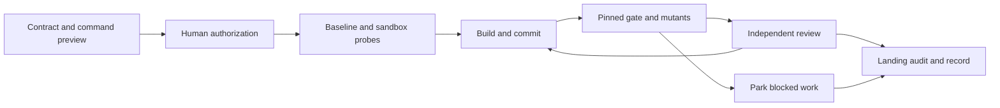

# Autopilot

Run a bounded, approved coding plan with committed machine checks, independent review and recoverable evidence. Every gate has three outcomes: **run** a check, **review** a claim, or **park** work that needs authority or access. Version **0.2.0-rc.2** includes the rc.1 repair work and maintainer compatibility fixes; see [CHANGELOG.md](CHANGELOG.md).



Use for a reversible plan with measurable criteria, a working Git repository and a clear execution boundary. **Do not start unattended runs** that require production credentials, unapproved publishing, changes to contract red lines, or work spanning **more than three unrelated modules**. Keep those tasks attended and narrow the scope first.

## Install and run

Requires Bash 3.2+, Git, Perl, Python 3, jq; `env-clean` runs without an OS sandbox and discloses that source protection is not OS-enforced when the backend is unavailable. Strict policies require macOS `sandbox-exec` or Linux `bwrap` with usable user namespaces. Tests need Bats and ShellCheck (`brew install bats-core shellcheck` on macOS; distro equivalents on Linux). Strict runs are offline: provision dependencies before takeoff.

Install the **complete package** from a clean local checkout (or unpacked release),
including scripts, templates, briefs, examples and training fixtures. Tests, CI configuration and historical validation records are excluded. The installer
copies committed Git bytes, excludes `.git` and untracked files, and refuses an
existing destination unless `--replace` is explicit:

```sh
python3 scripts/install-skill.py --host codex --dry-run
python3 scripts/install-skill.py --host codex --replace
python3 scripts/install-skill.py --host claude-code --replace
python3 scripts/install-skill.py --host zcode --replace
python3 scripts/install-skill.py --host ccmr --replace
```

| Host | Default global destination | Invocation policy |
|---|---|---|
| Codex | `${CODEX_HOME:-~/.codex}/skills/autopilot` | explicit `$autopilot`; `agents/openai.yaml` preserved |
| Claude Code | `${CLAUDE_CONFIG_DIR:-~/.claude}/skills/autopilot` | explicit `/autopilot`; frontmatter adapter |
| ZCode | `~/.agents/skills/autopilot` (shared user skills) | explicit invocation; frontmatter adapter |
| ccmr | `~/.claude-gateway/skills/autopilot` | explicit `/autopilot`; frontmatter adapter |

Use `--dest /absolute/path/to/autopilot` to override a host default, including a
ZCode-specific `~/.zcode/skills/autopilot` installation. ccmr deliberately uses the
gateway directory independently of `CLAUDE_CONFIG_DIR`; it does not change a
launcher, account, route or credential. Set `AUTOPILOT_HOME` to the installed
folder when invoking helpers directly; the skill itself uses its loaded directory.
ZCode's shared directory may also be discovered by other tools; avoid maintaining
an older higher-priority copy in `~/.zcode/skills`.

The canonical source retains `disable-model-invocation: true`, so Claude Code git-clone/git-pull installs stay manual-only. Claude Code, ZCode and ccmr installed copies preserve it in SKILL.md. Codex receives a copy with that Claude-specific key removed; every other payload file is copied unchanged. The installed `INSTALLATION.json` records the
source commit, original/installed SHA-256 inventory and backup path. Existing
folders are moved intact to a timestamped sibling `skill-backups` directory;
existing directory symlinks are retained, with a separate snapshot of their target.
Old files cannot survive in the new installation. No unrelated skill or host
configuration is touched. The installer refuses package symlinks and retains
failed staging directories under `skill-backups`, outside host skill discovery, for inspection.

For recovery, read the receipt, move the current installation aside, and restore
`<backup>/previous` to the recorded destination. For a previous symlink whose
target has since changed, restore the independent `<backup>/previous-target`
snapshot instead. No deletion is needed. Newly installed skills are available
on the next turn; start a new session if the host caches its skill catalog.

The optional [Codex CLI](https://github.com/openai/codex) can act as the adversarial
reviewer; without it, use a fresh reviewer context and record that it is from the
same model family. For Claude-compatible hosts, start with `/autopilot <goal or
plan path>` and resume with `/autopilot resume <run-record path>`.

The project contract (`docs/autopilot.md`) holds the approved commands and red
lines. The run record holds frozen criteria, current state, decisions and evidence.
`run-gate.sh` executes pinned checks; `run-mutant.sh` challenges their detectors;
`codex-review.sh` prepares or dispatches the reviewer; `api-review.py` runs a snapshot-only review by a cloud model such as DeepSeek; `validate-findings.sh`
validates its findings. Their headers and REFERENCE.md document CLI settings.

**Breaking migration:** existing contracts need a committed JSON policy; gates use fresh worktrees without untracked dependencies. Follow [the migration and offline setup guide](REFERENCE.md#migrating-an-existing-project) before upgrading an existing run.

Start with [SKILL.md](SKILL.md), then [the complete local example](examples/README.md). Copy the [contract template](CONTRACT-TEMPLATE.md), define its committed JSON policy, and preview commands before the approved run. [REFERENCE.md](REFERENCE.md) covers every setting, exit code, trust boundary and recovery path. `--lite` has fixed eligibility: ≤50 changed lines, one stage, low-risk documentation only, no network work or publishing; its landing audit remains mandatory.

## Verify

```sh
make check                    # Bats, ShellCheck, Python syntax
bash scripts/training-ground.sh /tmp/autopilot-demo-new
bash scripts/verify-evidence.sh /tmp/autopilot-demo-new/repo/evidence
```

Linux/macOS CI runs the same checks and the fixed training ground. A manifest binds evidence bytes to the reviewed commit; it is not an authenticated signature. `env-clean` sanitizes the environment and uses OS source protection when available. Without a usable backend it checks endpoint source snapshots and explicitly reports the weaker boundary; it cannot detect transient write/restore or isolate host filesystem/network access. Persistent helper/control tampering stops execution before helpers are reused. Outputs use `$AUTOPILOT_OUTPUT`, HOME/TMPDIR, or new `write_dirs` declared in policy. Strong-sandbox claims require passing live probes. CI publishes logs and training evidence as downloadable artifacts. The portable Linux job runs the full suite with host settings unchanged and with unavailable backends. Isolation-only tests explicitly skip when unavailable; the enforced-backend matrix forbids such skips and tests live isolation.

[MIT License](LICENSE).
