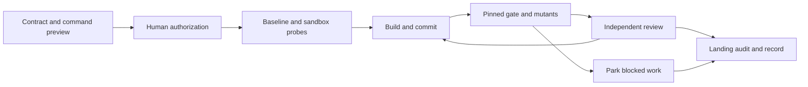

# Autopilot

Run a bounded, approved coding plan with committed machine checks, independent review and recoverable evidence. Every gate has three outcomes: **run** a check, **review** a claim, or **park** work that needs authority or access. Version **0.2.0-rc.2** repairs the independent rc.1 review findings; see [CHANGELOG.md](CHANGELOG.md) and the [validation report](VALIDATION.md).



Use for a reversible plan with measurable criteria, a working Git repository and a clear execution boundary. **Do not start unattended runs** that require production credentials, unapproved publishing, changes to contract red lines, or work spanning **more than three unrelated modules**. Keep those tasks attended and narrow the scope first.

## Install and run

Requires Bash 3.2+, Git, Perl, Python 3, jq; every execution needs macOS `sandbox-exec` or Linux `bwrap` with usable user namespaces for read-only source protection; restrictive policies add filesystem/network isolation. Tests need Bats and ShellCheck (`brew install bats-core shellcheck` on macOS; distro equivalents on Linux). Strict runs are offline: provision dependencies before takeoff.

For a local candidate, clone from the delivered local repository and select its tag. The remote command below works only after that tag is published. Install this entire folder, including `scripts/`, templates, briefs and `agents/`; do not copy only SKILL.md:

```sh
# Codex: choose a fresh destination; inspect/back up an existing installation first.
git clone --branch v0.2.0-rc.2 https://github.com/amenjason936/autopilot.git "$HOME/.codex/skills/autopilot"
export AUTOPILOT_HOME="$HOME/.codex/skills/autopilot"
```

Invoke explicitly as `$autopilot` with a plan or run record in Codex. The supplied `agents/openai.yaml` preserves manual invocation. Claude Code/ccmr installations use the same folder in the active host's skill directory; point `AUTOPILOT_HOME` there and invoke `/autopilot`. For Claude hosts, preserve their `disable-model-invocation: true` frontmatter setting in the installed copy. ccmr launchers must pass `AUTOPILOT_HOME` and the intended workdir explicitly; no hardcoded `~/.claude` path is required. This repository does not install a launcher or change your account configuration.

Start with [SKILL.md](SKILL.md), then [the complete local example](examples/README.md). Copy the [contract template](CONTRACT-TEMPLATE.md), define its committed JSON policy, and preview commands before the approved run. [REFERENCE.md](REFERENCE.md) covers every setting, exit code, trust boundary and recovery path. `--lite` has fixed eligibility: ≤50 changed lines, one stage, low-risk documentation only, no network work or publishing; its landing audit remains mandatory.

## Verify

```sh
make check                    # Bats, ShellCheck, Python syntax
bash scripts/training-ground.sh /tmp/autopilot-demo-new
bash scripts/verify-evidence.sh /tmp/autopilot-demo-new/repo/evidence
```

Linux/macOS CI runs the same checks and the fixed training ground. A manifest binds evidence bytes to the reviewed commit; it is not an authenticated signature. `env-clean` sanitizes the environment and protects source/Git from writes; it still permits other host/network access. Outputs use `$AUTOPILOT_OUTPUT`, HOME/TMPDIR, or new `write_dirs` declared in policy. Strong-sandbox claims require passing live probes. See [VALIDATION.md](VALIDATION.md) for what has actually been run and what remains unverified.

[MIT License](LICENSE).
